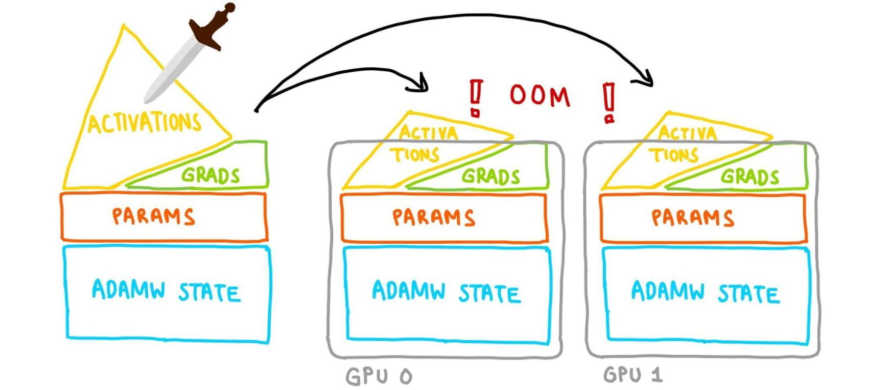
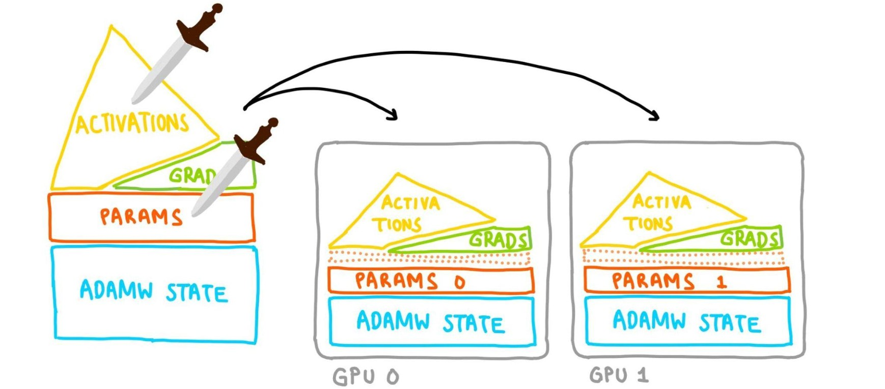
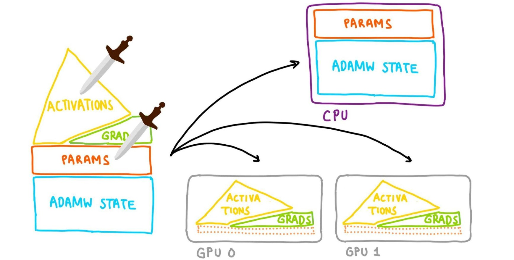
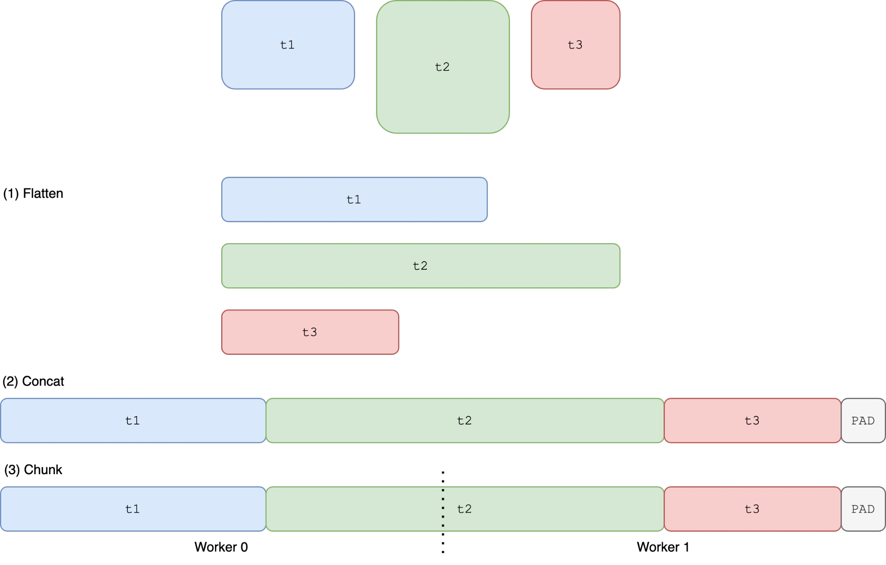
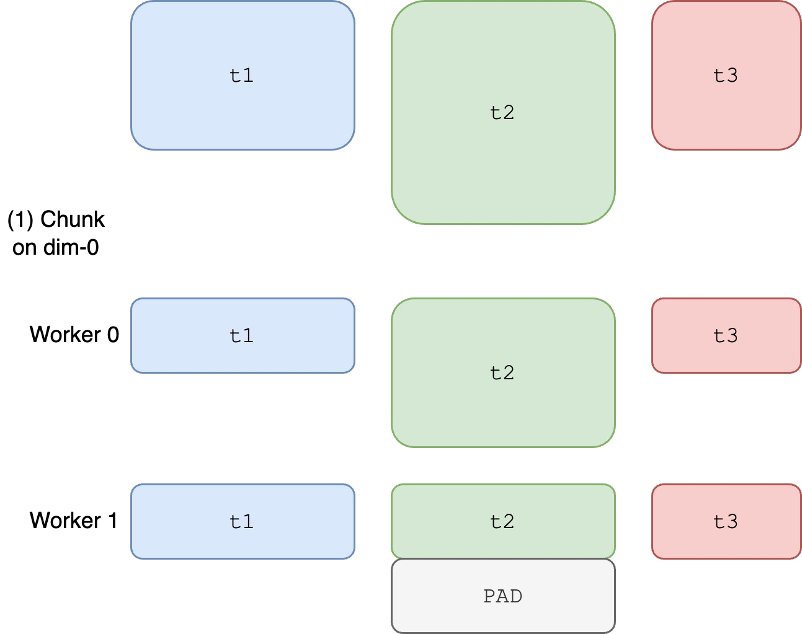

# 导论　用 PyTorch FSDP 和 torchao 解决显存不足

**Conference Talk 12: Slaying OOMs with PyTorch FSDP and torchao**

> **非官方中文译本** · 原作者：Christian Mills · 原文发布日期：2024 年 7 月 24 日。
> [原网页](https://christianjmills.com/posts/mastering-llms-course-notes/conference-talk-012/) · [翻译底本：2024 年历史版本](https://github.com/cj-mills/christianjmills/blob/4fe589582bbe57301cd1046764504686f085e64a/posts/mastering-llms-course-notes/conference-talk-012/index.md)。本译本依据该版本的 CC BY-NC-SA 4.0 许可制作，保留署名，并以相同许可提供非商业改编内容。

在这场演讲中，**Mark Saroufim** 和 **Jane Xu** 讨论了缓解 PyTorch 内存不足（Out of Memory，OOM）错误的技术与工具，重点关注大语言模型（LLM）的使用场景。

> **所属系列**
>
> 本文属于 Christian Mills 的 [《Mastering LLMs》课程笔记](https://christianjmills.com/series/notes/mastering-llms-course-notes.html)。该系列记录了 Hamel Husain 与 Dan Becker 主办的《Mastering LLMs: A Conference For Developers & Data Scientists》课程内容。

<a id="contents"></a>

## 本文目录

- [导论](#introduction)
- [理解模型的内存占用](#understanding-model-memory)
- [优化内存占用](#optimizing-memory-usage)
- [使用 FSDP 实现模型并行](#model-parallelism-with-fsdp)
- [FSDP2 基准测试](#benchmarking-fsdp2)

> **演讲资料**
>
> [Slaying OOMs 演示文稿及相关资料](https://drive.google.com/drive/u/0/folders/1HmGNC4v4L5nXhtdDMVCpUBrme1ELp-2C)

<a id="introduction"></a>

## 导论（Introduction）

- 使用大型 PyTorch 模型时，OOM 错误是常见的挑战。
- 减小批量大小或缩小模型等传统办法，能够发挥的作用有限。

> **译者说明**：这是一篇 2024 年演讲笔记的完整正文翻译。文中的 API、实现限制、“未来版本”的计划和性能数字均保留当时的语境，不代表当前 PyTorch、torchao 或 torchtune 的状态。补充说明均以“译者注”标明。


---

# 第 1 章　理解模型的内存占用（Understanding Model Memory）

> 译自 Christian Mills 的 [Conference Talk 12](https://christianjmills.com/posts/mastering-llms-course-notes/conference-talk-012/#understanding-model-memory)，原文发表于 2024 年 7 月 24 日。

<a id="understanding-model-memory"></a>

## 理解模型的内存占用（Understanding Model Memory）

- **显存容量限制**：现代 GPU 的显存容量有限，例如 RTX 3090 和 RTX 4090 都配备 24 GB 显存。这给大型模型训练带来了挑战。
- **模型内存占用的组成**：
  - **参数（parameters）**：即模型权重，通常以 FP16 存储，每个参数占 2 字节。对于拥有 70 亿个参数的 LLaMA 7B 模型，这部分需要 14 GB。
  - **梯度（gradients）**：在反向传播时计算，所需存储空间与参数相同；对于 LLaMA 7B，还需要另外 14 GB。
  - **优化器状态（optimizer state）**：Adam 等优化器需要保存额外信息，其大小通常是参数存储量的两倍；对于 LLaMA 7B，为 28 GB。
  - **激活（activations）**：模型各层产生的中间输出。
    - 激活的大小更难估算，取决于批量大小、上下文长度等因素。
    - 批量大小和上下文长度较大时，激活往往会成为内存占用的主要部分。
- **示例**：对 LLaMA 7B 进行全参数微调时，内存需求很容易超过 56 GB：参数 14 GB、梯度 14 GB、优化器状态 28 GB。这已经超过大多数消费级 GPU 的显存容量。
- **论坛文章**：[如何在不运行模型的情况下测量其内存占用？](https://dev-discuss.pytorch.org/t/how-to-measure-memory-usage-from-your-model-without-running-it/2024/1)

> **译者注：估算的适用范围**
>
> 上述 14 / 14 / 28 GB 是原文采用的简化估算，使用十进制 GB。实际占用取决于参数、梯度和优化器状态各自的存储精度，也可能包含主权重、临时缓冲区等额外开销；56 GB 的加和尚未计入激活。第 4 章实测表格使用的是 GiB，需保留这一区别。


---

# 第 2 章　优化内存占用（Optimizing Memory Usage）

> 译自 Christian Mills 的 [Conference Talk 12](https://christianjmills.com/posts/mastering-llms-course-notes/conference-talk-012/#optimizing-memory-usage)，原文发表于 2024 年 7 月 24 日。

<a id="optimizing-memory-usage"></a>

## 优化内存占用（Optimizing Memory Usage）

<a id="optimizer-memory"></a>

### 优化器内存（Optimizer Memory）

- **论文**：[Adam：一种随机优化方法](https://arxiv.org/abs/1412.6980)。
- SGD 等其他优化器的内存开销较低，看起来很有吸引力，但 Adam 因为效果良好，在实践中仍占主导地位。
- 替换 Adam 并不容易，而且未必能带来显著的内存节省。

<a id="parameter-quantization"></a>

### 参数量化（Parameter Quantization）

- **4 位量化**：将模型参数的精度从 FP16 降到 INT4，每个参数只占半个字节。
- 这一技术能显著减少内存占用。例如，LLaMA 7B 的参数存储量可以从 14 GB 降到 3.5 GB。
- **Torch Compile**：这个工具可以直接从 Python 代码生成高效的量化内核，无须手写专用 CUDA 内核。
  - 为 `quantize_tensor` 和 `dequantize_tensor` 函数添加 `@torch.compile()` 装饰器。

**示例：**

```python
import os
os.environ["TORCH_LOGS"] = "output_code"
import torch

@torch.compile()
def quantize_tensor(x_fp32):
    absmax = torch.max(torch.abs(x_fp32))
    c = 127.0 / absmax
    x_int8 = torch.round(c * x_fp32).to(torch.int8)
    return x_int8, c

@torch.compile()
def dequantize_tensor(x_int8, c):
    x_fp32 = x_int8.to(torch.float32) / c
    return x_fp32

x_int8, c = quantize_tensor(torch.randn(10, device="cuda"))
x_fp32 = dequantize_tensor(x_int8, c)
```

- **文档**：[`torch.compile`](https://pytorch.org/docs/stable/generated/torch.compile.html)。
- **教程**：[`torch.compile` 入门](https://pytorch.org/tutorials/intermediate/torch_compile_tutorial.html)。

> **译者注**：上文介绍的是 4 位参数量化，但原文这段示例代码实际演示的是 FP32 与 INT8 之间的量化、反量化，以及如何使用 `torch.compile`。它不是 INT4 或 NF4 的实现。代码按底本保留。

<a id="gradient-optimization-with-lora"></a>

### 使用 LoRA 优化梯度开销（Gradient Optimization with LoRA）

- 直接将梯度量化到 4 位会对收敛产生负面影响。
- **低秩适配（Low-Rank Adaptation，LoRA）**：通过只训练少量参数，也就是适配器，同时冻结其余大部分参数，绕开这一问题。
- **QLoRA**：将 LoRA 与参数量化结合，在不损害准确性的前提下显著减少内存占用。

<a id="challenges-and-solutions-with-qlora"></a>

### QLoRA 的挑战与解决办法（Challenges and Solutions with QLoRA）

- QLoRA 的实现可能很复杂，通常需要定制 CUDA 内核。例如，Tim Dettmers 的最初实现包含约 4,000 行 CUDA 代码。
  - 权重采用的不是 INT4，而是更适合正态分布数据的 NF4。
  - 无法直接对 NF4 张量进行矩阵乘法。
    - 需要先反量化，再执行矩阵乘法。
  - 不能对所有数据统一使用同一个最大值，否则会对离群值过于敏感。
  - 因此，量化通常按块进行，每个块使用独立的缩放因子。
  - QLoRA 还会量化这些缩放因子，这就是**双重量化（double quantization）**。
- **使用 Torch Compile 简化实现**：PyTorch 开发者 [Driss Guessous](https://github.com/drisspg) 利用 Torch Compile，用约 900 行 Python 代码实现了 QLoRA。
  - **代码**：[torchao/dtypes/nf4tensor.py（原文链接）](https://www.github.com/torchao/dtypes/nf4tensor.py)。
- **张量子类（tensor subclasses）**：PyTorch 的张量子类机制支持创建自定义数据类型，例如 QLoRA 使用的 NF4，从而更高效地表示和操作量化张量。

**示例：**

```python
return F.linear(input, weight.to(input.dtype))
```

- **文档**：[`torch.Tensor`](https://pytorch.org/docs/stable/tensors.html)。
- **示例集合**：[`subclass_zoo`](https://github.com/albanD/subclass_zoo/)，包含多个 PyTorch 张量子类示例。

> **译者注**：上面的 `nf4tensor.py` 地址按原文保留，但其路径不完整；请把它视为历史引用，而非已验证可用的安装或源码入口。本文没有将 2024 年的实现描述替换成当前版本的实现。


---

# 第 3 章　使用 FSDP 实现模型并行（Model Parallelism with FSDP）

> 译自 Christian Mills 的 [Conference Talk 12](https://christianjmills.com/posts/mastering-llms-course-notes/conference-talk-012/#model-parallelism-with-fsdp)，原文发表于 2024 年 7 月 24 日。

<a id="model-parallelism-with-fsdp"></a>

## 使用 FSDP 实现模型并行（Model Parallelism with FSDP）

<a id="data-parallism"></a>

### 数据并行（Data Parallelism）

- **数据并行**：将批量数据分配到多个设备上，同时在每个设备上保留一份梯度、模型参数和优化器状态。
- 单纯使用数据并行虽然有帮助，但对于特别大的模型，仍然可能不够。



*数据并行下仍然出现 OOM——《Slaying OOMs》第 19 页。*

<a id="fsdp"></a>

### 全分片数据并行（FSDP）

- **全分片数据并行（Fully Sharded Data Parallel，FSDP）**：将模型参数分布到多张 GPU 上，相应的梯度与优化器状态也随之分片，因此能够训练超过单设备内存容量的模型。
  - 某一层处理完成后，会释放与该层处理相关的内存。



*FSDP 内存占用——《Slaying OOMs》第 21 页。*

- **分片（sharding）**：将模型的组成部分拆成更小的块，也就是分片，再将它们放到不同 GPU 上。
- **all-gather 操作**：在模型训练期间，从不同 GPU 收集计算所需的数据。
- **层（layers）**：
  - 每个 PyTorch `nn` 模块都可以看成由更多 `nn` 模块构成的一棵树。
  - 用户设置的包装策略（wrapping policy）决定哪些部分会被视为独立的“层”。
  - 选择包装哪些部分会影响内存占用。
    - 包装单元越小，每次 all-gather 需要收集的数据就越少。
- **CPU 卸载（CPU offloading）**：
  - 可以把参数保留在 CPU 上，在进行前向与反向计算时，再把它们移到 GPU 上。
  - 优化器更新在 CPU 上执行，因此优化器状态也保留在 CPU 内存中。



*FSDP 的 CPU 卸载——《Slaying OOMs》第 25 页。*

<a id="fsdp1-vs.-fsdp2"></a>

### FSDP1 与 FSDP2（FSDP1 vs. FSDP2）

- **目标**：高效地执行 all-gather。
- **约束**：[NCCL](https://developer.nvidia.com/nccl)，即 NVIDIA 集体通信库，要求参与的各张 GPU 提供大小相同的张量。

**FSDP1：**

- 在分片之前，先将所有张量展平并拼接起来。这可能带来类型和元数据方面的冲突。



*使用 FlatParam 的 FSDP——《Slaying OOMs》第 28 页。*

- `t1` 与 `t2` 的第一部分合并成一个张量。
- `t2` 的第二部分与 `t3` 合并成一个张量。
- `t2` 被拆分到不同 GPU 上。
- 这要求 `t1`、`t2` 和 `t3` 使用相同的数据类型（dtype）及其他元数据。
- 这种方式可能出现不确定的内存峰值，使内存管理更加困难。

**FSDP2，即逐参数 FSDP（Per-Parameter FSDP）：**

- 引入分布式张量（DTensor，原文写作 D-tensors），支持对每个张量单独分片，同时保留各自的数据类型和元数据。



*逐参数 FSDP——《Slaying OOMs》第 30 页。*

- 提供更好的内存确定性，使内存占用更容易预测和管理。
- 支持更灵活、高效的训练场景，尤其适合与 QLoRA 等技术组合使用。
- 相比 FSDP1，在 all-gather 期间需要额外的数据复制。
- **论坛文章**：[FSDP 与 CUDACachingAllocator：一位新手旁观者的视角](https://dev-discuss.pytorch.org/t/fsdp-cudacachingallocator-an-outsider-newb-perspective/1486/1)。

<a id="cpu-offloading"></a>

### CPU 卸载（CPU Offloading）

- 利用 CPU 内存保存参数和优化器状态，进一步降低 GPU 的内存负担。
- 将优化器步骤卸载到 CPU，让 GPU 专注于计算密集的前向与反向传播。

> **译者注**：“Model Parallelism with FSDP” 是原文的章节标题，按原意保留。FSDP 的全称仍为“全分片数据并行”；这里讨论的是模型状态分片，不表示把完整的不同层分配给不同 GPU 执行流水线并行。插图保留原图，图题已译为中文。


---

# 第 4 章　FSDP2 基准测试（Benchmarking FSDP2）

> 译自 Christian Mills 的 [Conference Talk 12：Benchmarking FSDP2](https://christianjmills.com/posts/mastering-llms-course-notes/conference-talk-012/#benchmarking-fsdp2)，原文发表于 2024 年 7 月 24 日。

<a id="benchmarking-fsdp2"></a>

## FSDP2 基准测试（Benchmarking FSDP2）

<a id="benchmarking-plan"></a>

### 基准测试计划（Benchmarking Plan）

- **目标**：运行基准测试，找出 FSDP2 与基线方案（FSDP1 + bnb）之间的性能差距，并探索提升 FSDP2 速度的方法。
- **硬件**：通过 Vast AI 租用的两张 NVIDIA RTX 3090；这是消费级 GPU，每张配备 24 GB 显存。
- **基线**：Answer.ai 的 `train.py`，使用 FSDP1 和 bnb，批量大小为 8。

> **译者注**：bnb 是 bitsandbytes 的常用缩写。这里比较的是两套具体训练实现；后续小节会逐步排除配置和实现差异，不能把最初的耗时差异全部归因于 FSDP 版本。

<a id="initial-benchmarking-and-discrepancies"></a>

### 初始测试与差异（Initial Benchmarking and Discrepancies）

**测试环境：**

- [Answer.ai 的 `train.py`](https://github.com/AnswerDotAI/fsdp_qLoRA/blob/main/train.py)，使用命令行配置：

```sh
python train.py --model_name meta-llama/Llama-2-7b-hf --batch_size 8 --context_length 2048 --train_type \
  qLoRA --use_gradient_checkpointing True --reentrant_checkpointing True --dataset dummy --dataset_samples \
  48
```

- [TorchTune recipe](https://github.com/pytorch/torchtune/blob/1fa1f04baf124c074dcd93831fa38c8b657af1e9/recipes/configs/dev/llama2/7B_qLoRA_fsdp2.yaml)，使用 YAML 配置。

> **译者注**：原文命令被直接折成了三行。这里仅补上 shell 续行符 `\`，保留所有参数和值，便于完整复制。这是历史示例，本次翻译没有实际启动训练或验证其在当前环境中的可运行性。

**初始结果：**

| 实现 | 批量大小 | 峰值内存 | 单步运行时间 |
|---|---:|---:|---:|
| train.py | 8 | 12.88 GiB | 14.0 s |
| torchtune | 8 | 12.60 GiB | 16.5 s |

- FSDP2 的峰值内存占用更低。
- FSDP2 的运行速度更慢。

**使用 Perfetto 分析 trace：**

- **博客文章**：
  - [理解 GPU 内存，第 1 篇：可视化随时间变化的所有内存分配](https://pytorch.org/blog/understanding-gpu-memory-1/)。
  - [理解 GPU 内存，第 2 篇：查找并移除引用环](https://pytorch.org/blog/understanding-gpu-memory-2/)。
- **trace 文件**：
  - Google Drive：[answer.ai train.py](https://drive.google.com/file/d/1ObfUUySBwuaCSLMXRxFiM1w7XYMebxvB/view)。
  - Google Drive：[torchtune](https://drive.google.com/file/d/1BpdlZZ55746IHcifho2u2okJQ1ihr8dY/view)。
- **[Perfetto](https://ui.perfetto.dev/)**：用于性能插桩和 trace 分析的生产级开源工具集。
- **优化器步骤数量存在显著差异**：FSDP2 中的优化器耗时明显更长。
- **操作数量翻倍**：这表明 FSDP2 方案可能训练了比基线更多的参数。

> **译者注**：原文在这里使用了“优化器步骤数量”的表述，随后又讨论“操作数量”。应结合 trace 中的具体事件理解，不宜直接解读为训练循环执行了两倍的全局更新步数。

<a id="identifying-the-root-causes"></a>

### 确定根本原因（Identifying the Root Causes）

- **根因 1：配置不一致**
  - TorchTune recipe 还为输出投影添加了 LoRA，每层增加两个低秩适配器，因此比 `train.py` 多出 64 个参数。
- **根因 2：张量子类的分派开销**
  - 分布式张量（DTensor）在内核调用期间需要解包元数据，因此会引入额外开销。
  - 参数数量增加进一步放大了这些开销，使 FSDP2 中的优化器步骤显著变慢。

> **译者注**：原文写的是“64 additional parameters”。结合“每层增加两个低秩适配器”和逐参数分派的上下文，这里应理解为额外的参数张量对象，而非仅仅多出 64 个标量权重；这是对原文措辞的解释。

<a id="addressing-the-discrepancies-and-further-benchmarking"></a>

### 消除差异并进一步测试（Addressing the Discrepancies and Further Benchmarking）

- **确保在相同条件下比较**：
  - 统一各项测试使用的数据集、参数数量和包装策略。
- **统一配置后的结果**：
  - FSDP2 的运行速度仍然较慢。
  - 峰值内存占用显著改善。
- **进一步分析**：
  - 将前向传播、反向传播和优化器作为排查剩余性能差距的主要方向。

<a id="deep-dive-into-performance-gaps"></a>

### 深入分析性能差距（Deep Dive into Performance Gaps）

**差距 1：优化器步骤变慢**

- **问题**：DTensor 的额外开销使优化器步骤耗时达到原来的约 3 倍。
- **解决办法**：与 Intel 合作开发融合 Adam 优化器内核，通过单次分派和向量化实现约 8 倍加速。

**差距 2：all-gather 操作的数据量更大**

- **问题 1**：与基线不同，FSDP2 将更多数据打包进 all-gather，包括标量和量化因子。
- **问题 2**：不对输出投影使用 LoRA 时，FSDP2 方案没有量化该投影，导致它的数据量达到基线的 4 倍。
- **解决办法**：
  - 问题 1 属于预期行为。
  - 问题 2 将由 TorchTune 在未来版本中解决。

**差距 3：反量化开销**

- **问题**：为了供 CUDA 内核使用，FSDP2 方案需要把 NF4 反量化为 BF16；这一过程的效率低于基线中的专门实现。
- **解决办法**：探索使用 Torch Compile、自定义 Torch 内核或 Triton 内核，加速反量化。

**差距 4：RoPE 算法不同**

- **问题**：TorchTune 与基线使用了不同的旋转位置编码（RoPE）算法，导致缩放点积注意力（SDPA）之前执行的操作不同。
- **解决办法**：TorchTune 将提供更多 RoPE 算法选择。

**差距 5：通信与计算的重叠**

- **问题**：FSDP2 更严格的内存管理暴露了 CPU 卸载与计算重叠不足的问题。计算任务远小于通信任务，因而产生了空闲时间。
- **解决办法**：调整包装策略，以不同方式对层进行分组，使通信和计算能够更好地重叠，减少空闲时间。原文指出，这个方案只有 FSDP2 能实现，因为它能处理同一层内的混合精度。

> **译者注：性能数字与时间背景**
>
> “3 倍”和“8 倍”针对本节的优化器步骤或相关优化，不表示端到端训练速度提升了 8 倍。原文没有给出全部优化完成后的最终单步耗时。“未来版本”和“只有 FSDP2 能实现”均保留 2024 年演讲中的限定场景，不作为当前版本的通用结论。


---

# 参考资源　来源、术语与翻译说明

<a id="source-version"></a>

## 原文与版本（Source Version）

- **标题**：Conference Talk 12: Slaying OOMs with PyTorch FSDP and torchao。
- **作者**：Christian Mills。
- **演讲者**：Mark Saroufim、Jane Xu。
- **发布日期**：2024 年 7 月 24 日。
- **原网页**：[文章入口](https://christianjmills.com/posts/mastering-llms-course-notes/conference-talk-012/)。
- **用户指定小节**：[Benchmarking FSDP2](https://christianjmills.com/posts/mastering-llms-course-notes/conference-talk-012/#benchmarking-fsdp2)。
- **翻译底本**：[Git 提交 `4fe589582bbe57301cd1046764504686f085e64a` 中的原文 Markdown](https://github.com/cj-mills/christianjmills/blob/4fe589582bbe57301cd1046764504686f085e64a/posts/mastering-llms-course-notes/conference-talk-012/index.md)。
- **该版本许可**：[LICENSE.txt](https://github.com/cj-mills/christianjmills/blob/4fe589582bbe57301cd1046764504686f085e64a/LICENSE.txt)，CC BY-NC-SA 4.0。
- **翻译日期**：2026 年 9 月 20 日。

<a id="translation-scope"></a>

## 翻译范围（Translation Scope）

译文覆盖底本的全部技术正文：5 个主要章节、13 个小节、5 张插图及其图题、3 个代码块、1 张基准数据表，以及系列说明和演讲资料入口。按照参考目录拆分为逐章 Markdown，并提供完整译文和静态 HTML 阅读页。

图片保留原图，图题译为中文，图片内的英文标签保留。网页导航、评论组件与当前网站后来添加的作者推广卡片不属于本次历史底本的技术正文。原始资料中的外部链接予以保留；访问这些资源仍需要联网。

原文采用提纲式笔记，译文保留原有层次与顺序。页面增加目录、前后章导航与来源说明，不增加原文没有的交互实验。完整译文和章节页都保留英文小节锚点。

<a id="terminology"></a>

## 术语对照（Terminology）

| 英文 | 本译文用语 |
|---|---|
| Out of Memory / OOM | 内存不足；GPU 场景下也称显存不足 |
| VRAM | 显存 |
| parameters / weights | 参数／权重 |
| gradients | 梯度 |
| optimizer state | 优化器状态 |
| activations | 激活 |
| quantization / dequantization | 量化／反量化 |
| scale / scaling factor | 缩放因子 |
| Low-Rank Adaptation / LoRA | 低秩适配 |
| double quantization | 双重量化 |
| tensor subclass | 张量子类 |
| Fully Sharded Data Parallel / FSDP | 全分片数据并行 |
| sharding | 分片 |
| all-gather | all-gather，按上下文解释为收集分片数据 |
| wrapping policy | 包装策略 |
| CPU offloading | CPU 卸载 |
| distributed tensor / DTensor | 分布式张量 |
| dispatch | 分派 |
| fused Adam optimizer kernel | 融合 Adam 优化器内核 |
| rotary positional embeddings / RoPE | 旋转位置编码 |
| scaled dot-product attention / SDPA | 缩放点积注意力 |
| trace | trace／执行轨迹 |
| bnb | bitsandbytes |

<a id="translation-notes"></a>

## 翻译与编辑说明（Translation Notes）

- 使用简体中文，与参考目录的实际内容一致；目录名中的 `zh-tw` 不作为译文字体依据。
- Python 示例原样保留。Shell 示例只添加续行符，参数及其取值不变。
- 保留所有基准数字以及 GB / GiB 的区别，没有重新进行 GPU 性能测试。
- 原文的 `Data Parallism`、`multipls` 等拼写问题不带入中文；数据并行小节的链接仍使用原始 `data-parallism` 锚点。
- 规范人名 Tim Dettmers 与术语 DTensor、RoPE 的拼写。
- 对 INT8 示例与 4 位量化的区别、64 个参数的含义、优化器局部加速等歧义单独标注译者注。
- 原文损坏的 `nf4tensor.py` 链接按历史引用保留并提示，未虚构一个可用的新地址。
- 原文关于后续版本的计划、性能瓶颈和实现限制均属于 2024 年上下文，未改写成当前产品状态。

<a id="licenses"></a>

## 许可与署名（Licenses）

本文采用已发布的历史版本作为底本，该提交中的内容许可为 **Creative Commons Attribution-NonCommercial-ShareAlike 4.0 International（CC BY-NC-SA 4.0）**。译文作为非官方中文改编，采用相同许可，并保留原作者、原作链接和修改说明。作者当前仓库的内容许可与此历史版本不同，请勿把本说明扩展到后来新增的内容。

原文中的代码对应作者仓库的 MIT 许可；阅读页样式源自本地 `ultrascale-playbook-zh-tw`，其模板许可为 Apache 2.0，原项目维护者为 Twinkle AI Community。Markdown 渲染器 marked v12.0.2 使用 MIT 许可。各许可与来源记录保存在本项目的 `licenses/` 和 `NOTICE.md` 中。
